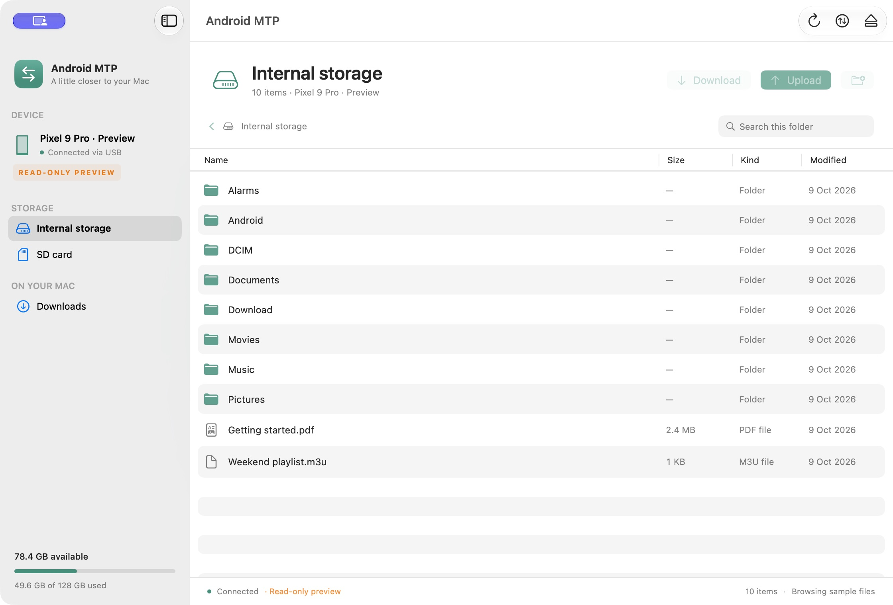

# Android MTP for Mac

A native **SwiftUI macOS app for Apple Silicon** that browses Android storage
and transfers files over USB using [libmtp](https://github.com/libmtp/libmtp)
and [libusb](https://github.com/libusb/libusb). No web view, ADB, Android companion
app, or network service is involved.



## Run

[Download the Apple Silicon preview release](https://github.com/junedkhatri31/android-mtp/releases/tag/v1.0.0),
extract `AndroidMTP-arm64.zip`, and open **Android MTP.app**. If you built from
source, open `dist/Android MTP.app` instead. Connect your Android device with a USB **data** cable,
unlock it, and choose **File transfer / Android Auto** in the phone's USB notification.
The app automatically opens a single detected device; with multiple devices,
choose one from the connection screen. Click Refresh or press **⌘R** to scan again.
Quit any other MTP apps if the connection cannot be opened.

Requires an M-series Mac and macOS 14 or later. The app bundles its arm64 USB
libraries; Homebrew is not needed to run the packaged app. It is locally ad-hoc
signed, not Developer ID signed or notarized. This is an initial preview:
automated tests and UI checks pass, but transfers with physical Android hardware
have not yet been verified. See the [validation record](docs/VALIDATION.md).

## Features

- Native device/storage sidebar, storage usage indicator, sortable file table,
  folder breadcrumbs, and search within the current folder.
- Upload files and entire folders with the Upload button, **⌘U**, or a drop from Finder.
- Select files or folders and Download (**⌘D**) to a destination on your Mac.
  Double-click folders to browse them; double-click files to download them.
- Create folders (**⇧⌘N**), rename, and permanently delete items from the context menu.
  Deleting a folder confirms removal of its entire contents.
- Sequential transfer queue with per-item progress, errors, cancellation, and
  Show in Finder for completed downloads. Toggle the queue with **⇧⌘T**.
- Disconnect (**⌘E**) releases the USB session. Settings (**⌘,**) supports system,
  light, and dark appearance.

The browser stays available on screen during transfers, with device actions
disabled until the queue finishes. Cancelling queued items skips them; cancelling
an active transfer interrupts it when libmtp invokes the next USB progress callback.
Quitting during transfers offers to keep transferring or cancel; quit again after
cancellation finishes.

## Build from source

Install Xcode or its command-line tools (Swift 6+) and `pkg-config`:

```sh
git clone https://github.com/junedkhatri31/android-mtp.git
cd android-mtp
brew install pkg-config
bash scripts/build-app.sh
open "dist/Android MTP.app"
```

The script downloads **checksum-verified, pinned** source releases of libusb 1.0.30
and libmtp 1.1.23, builds them for arm64 / macOS 14, builds the Swift executable,
generates an app icon, bundles and relocates all non-system dylibs, includes their
licenses, and ad-hoc signs the app. It also produces `dist/AndroidMTP-arm64.zip`.
The first dependency build needs an internet connection. Later builds reuse
`.dependencies/`; remove that directory to rebuild the USB libraries.

For faster development using Homebrew libraries instead:

```sh
brew install libmtp
MTP_DEPENDENCY_PREFIX="$(brew --prefix)" swift run AndroidMTP
```

SwiftPM uses this project's `.dependencies/` by default. Run the dependency build
script before using `swift build`, `swift run`, or `swift test` directly.
Set `MTP_DEPENDENCY_PREFIX` to use another library installation.
An installed Homebrew bottle may require a newer macOS than 14; the release build
avoids that by compiling its own dependencies.

Open `Package.swift` in Xcode to work on the native Swift sources. This executable
uses direct USB access outside the App Sandbox. No entitlements are required for
the local, non-sandboxed bundle.

## Preview without a phone

```sh
open "dist/Android MTP.app" --args --demo
# Or: swift run AndroidMTP --demo
```

Preview mode shows clearly labelled sample device storage and folders.
It is read-only and never attempts a USB transfer. Quit an already-running
instance first so Launch Services passes the preview argument to a fresh process.

## Validation

```sh
bash scripts/build-dependencies.sh
swift test
bash scripts/build-app.sh
codesign --verify --deep --strict "dist/Android MTP.app"
```

The automated tests exercise real temporary directories with a simulated MTP
transport: recursive uploads/downloads, parent mapping, byte-size verification,
duplicate-name protection, preflight validation, symlink rejection, cancellation,
partial-download cleanup, and child-first recursive deletion. These tests cannot
establish compatibility with a particular phone; actual USB transfers still need
to be verified with physical Android hardware.

## Transfer behavior

Existing destination names are rejected instead of overwritten or merged.
Name checks also reject paths, control characters, colons, and names longer than
255 UTF-8 bytes, and guard against case-equivalent duplicates. Symbolic links and
special local files are rejected before an upload starts.

Downloads go to hidden `.partial` files in the selected destination folder and
are moved to their final names only after success and byte-count verification.
Failed partial downloads are removed. On cancellation or failure of a folder
transfer, already-completed files and any created folders remain; the operation
is not an all-or-nothing transaction. Failed uploads attempt to remove the current
incomplete remote object when libmtp provides its ID; a USB disconnect may prevent
this cleanup. Refresh after reconnecting to check the destination.

MTP provides object-level operations rather than a mounted filesystem. This app
does not provide Finder mounting, resumable transfers, thumbnail fetching,
background synchronization, or remote file editing. Phone firmware controls
which folders are accessible; unlock the device and keep its File transfer mode
enabled. Long USB timeouts can delay cancellation, although the Mac UI stays responsive.

## Layout and licenses

`Sources/MTPBridge` owns libmtp C data and its atomic cancellation flag.
`Sources/AndroidMTPCore` provides an actor-isolated USB transport and recursive
transfer engine. `Sources/AndroidMTP` contains the SwiftUI browser and queue.
`scripts/` builds dependencies and the distributable bundle.

Application code: [MIT](LICENSE). Bundled USB libraries:
[LGPL-2.1-or-later](Licenses/THIRD-PARTY.md), with complete license texts included
in the app's `Contents/Resources/Licenses` directory. The matching unmodified
library source archives are also attached to the preview release.
